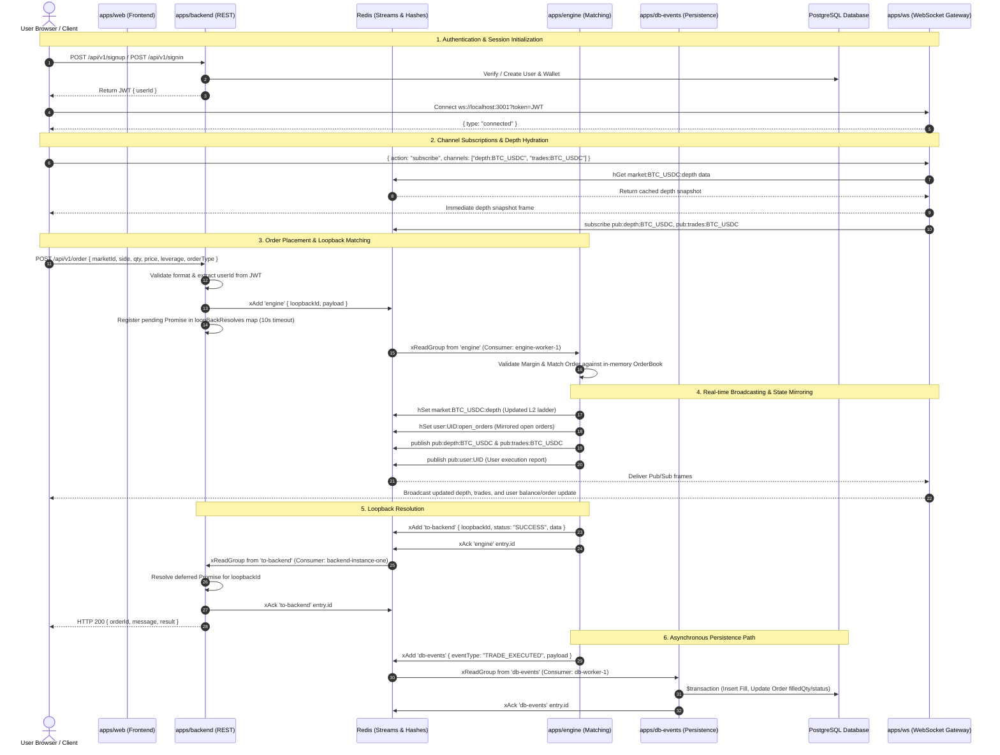

# Application Flow and Inter-Service Coordination

This document details how the microservices in the Perps platform interact across Redis streams, Pub/Sub channels, in-memory caches, and PostgreSQL.

---

## 1. Inter-Service Communication Topology

The platform coordinates four backend processes and client-facing interfaces:

---

## 2. Service Startup Sequence

To ensure seamless coordination and prevent missing dependencies, services must start in the following strict order:

### Step 1: Infrastructure Layer
1. **PostgreSQL**: Must be running, accepting connections on port 5432 with active schema migrations applied via `bun run --filter db prisma:migrate`.
2. **Redis**: Must be running, accepting connections on port 6379.

### Step 2: Engine Boot & Hydration Layer (`apps/engine`)
* Connects to Redis and initializes consumer group `engine-consumer-group` on stream `engine`.
* Executes `bootstrapEngine()`:
  - Queries `prisma.market.findMany()` $\to$ registers in-memory orderbooks.
  - Queries `prisma.wallet.findMany()` $\to$ hydrates in-memory balances.
  - Queries `prisma.position.findMany()` $\to$ hydrates open positions.
  - Queries `prisma.order.findMany({ where: { status: { in: ["OPEN", "PARTIALLY_FILLED"] } } })` $\to$ inserts resting orders into orderbooks and mirrors to Redis Hashes.
* Spawns background daemons:
  - `startLiquidationPoller()`: Runs every 1,000ms.
  - `startFundingRatePoller()`: Runs every 1 hour (3,600,000ms).
  - `startBinanceWebSocket()`: Initiates persistent WebSocket connection to Binance futures for mark prices.
* Begins infinite `xReadGroup` loop on stream `engine`.

### Step 3: Persistence Layer (`apps/db-events`)
* Connects to Redis and registers consumer group `db-consumer-group` on stream `db-events`.
* Begins polling stream `db-events` with a 2,000ms block interval and batch size of 20 messages.

### Step 4: Gateways (`apps/backend` and `apps/ws`)
* **`apps/backend`**:
  - Connects to Redis and initializes consumer group `backend-consumer-group` on stream `to-backend`.
  - Spawns background consumer loop for resolving loopback promises.
  - Binds HTTP server to port 3000.
* **`apps/ws`**:
  - Connects to Redis Pub/Sub client and reader client.
  - Subscribes to pattern `pub:user:*`.
  - Binds WebSocket gateway to port 3001.

### Step 5: Presentation Layer (`apps/web`)
* Vite development server binds to port 5173.
* Establishes initial REST queries for markets and connects to WebSocket on port 3001.
