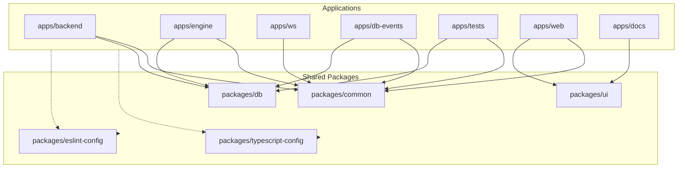

# Monorepo Architecture

The Perps platform is organized as a unified monorepo managed with **Turborepo** and **Bun Workspaces**. This structure enforces type sharing, centralized configuration, and independent deployability of distinct services while sharing database schemas and domain models.

---

## 1. Workspace Layout

The root configuration file [package.json](file:///c:/Users/777su/Desktop/Perps_Project/Perps/package.json) defines two primary workspace glob patterns:
```json
{
  "workspaces": [
    "apps/*",
    "packages/*"
  ]
}
```

```
Perps/
├── package.json               # Root workspace metadata and Turborepo devDependencies
├── turbo.json                 # Turborepo task pipelines and caching rules
├── bun.lock                   # Deterministic dependency lockfile
├── AGENTS.md                  # Turborepo-managed agent guidance block
├── README.md                  # Root project documentation
├── docs/                      # Canonical technical documentation
├── apps/
│   ├── backend/               # REST API HTTP service (Express)
│   ├── engine/                # Core in-memory matching and risk engine
│   ├── ws/                    # WebSocket streaming gateway
│   ├── db-events/             # Redis-to-PostgreSQL persistence worker
│   ├── tests/                 # 24-suite integration test harness
│   ├── web/                   # Vite + React trading user interface
│   └── docs/                  # Next.js documentation portal scaffold
└── packages/
    ├── common/                # Shared domain types, unions, and event schemas
    ├── db/                    # Prisma 7 schema, PostgreSQL migrations, client
    ├── eslint-config/         # Shared ESLint configuration presets
    ├── typescript-config/     # Shared tsconfig.json compiler configurations
    └── ui/                    # Shared React UI components (button, card, code)
```

---

## 2. Dependency Graph and Inter-Package Linkage



### Shared Package Responsibilities:
1. **`packages/common`**: Contains no external runtime dependencies. Exports TypeScript type definitions (`toEngine`, `DbEventMessage`, `OrderAcceptedPayload`, `MirrorOpenOrder`, etc.) used across the backend, engine, worker, and frontend.
2. **`packages/db`**: Encapsulates Prisma ORM schemas, database migrations, and exposes the initialized singleton `prisma` client backed by `@prisma/adapter-pg`.
3. **`packages/typescript-config`**: Standardizes TypeScript compiler options across all packages (`base.json`, `nextjs.json`, `react-library.json`).
4. **`packages/eslint-config`**: Standardizes linting rules (`base.js`, `next.js`, `react-internal.js`).
5. **`packages/ui`**: Component library housing shared React UI primitives.

---

## 3. Turborepo Task Pipeline

The repository's task pipelines are configured in [turbo.json](file:///c:/Users/777su/Desktop/Perps_Project/Perps/turbo.json):

```json
{
  "$schema": "https://turborepo.dev/schema.json",
  "ui": "tui",
  "tasks": {
    "build": {
      "dependsOn": ["^build"],
      "inputs": ["$TURBO_DEFAULT$", ".env*"],
      "outputs": [".next/**", "!.next/cache/**", "!.next/dev/**"]
    },
    "lint": {
      "dependsOn": ["^lint"]
    },
    "check-types": {
      "dependsOn": ["^check-types"]
    },
    "dev": {
      "cache": false,
      "persistent": true
    }
  }
}
```

### Pipeline Execution Behavior:
* **`build`**: Topologically builds upstream dependencies first (`^build`). Passes `.env*` inputs and captures Next.js production output.
* **`check-types`**: Runs `tsc --noEmit` across all 12 monorepo packages in dependency order to ensure 100% static type safety across package boundaries.
* **`lint`**: Runs project linting rules across all workspaces.
* **`dev`**: Configured as `cache: false` and `persistent: true` to support concurrent long-running daemons during local development.
