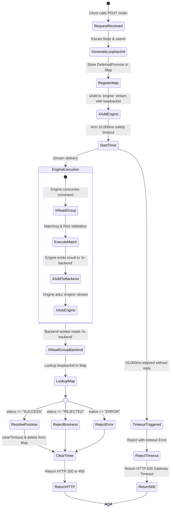

# Request Lifecycle: Synchronous Loopback Over Asynchronous Streams

One of the most critical architectural patterns in the Perps trading platform is the **Synchronous HTTP Loopback Over Asynchronous Redis Streams**.

This pattern allows clients to use standard RESTful HTTP semantics (`POST /api/v1/order` returns HTTP 200 with the matching engine execution result) while decoupling the HTTP thread pool from matching engine execution.

---

## 1. Loopback Architecture and State Machine

The loopback mechanism is implemented in [apps/backend/loopback.ts](file:///c:/Users/777su/Desktop/Perps_Project/Perps/apps/backend/loopback.ts).

### Components:
* **`loopBackResolves`**: An in-memory `Map<string, DeferredPromise>` residing in `apps/backend`.
* **`DeferredPromise`**: An object containing `{ resolve, reject, timer }`.
* **Stream `engine`**: Stream where the backend queues operations for the matching engine.
* **Stream `to-backend`**: Stream where the matching engine writes replies back to the backend.



---

## 2. Detailed Step-by-Step Code Walkthrough

### Step A: Client Request & ID Generation
When a client hits an endpoint requiring engine execution (e.g., `POST /api/v1/order`), the controller invokes `loopback(command)`:
```typescript
// apps/backend/loopback.ts
export function loopback(message: toEngine): Promise<unknown> {
  return new Promise((resolve, reject) => {
    // Cryptographically secure UUIDv7 for monotonic ordering
    const loopbackId = randomUUIDv7();

    const pendingPromise: DefferedPromise = { resolve, reject };
    loopBackResolves.set(loopbackId, pendingPromise);

    client.xAdd("engine", "*", { loopbackId, payload: JSON.stringify(message) })
      .then(() => {
        // Arm 10-second timeout guard
        pendingPromise.timer = setTimeout(() => {
          const currentPendingPromise = loopBackResolves.get(loopbackId);
          if (currentPendingPromise) {
            loopBackResolves.delete(loopbackId);
            currentPendingPromise.reject(
              new Error(`Engine loopback timed out after 10000 for id ${loopbackId}`)
            );
          }
        }, 10000);
      })
      .catch((error) => {
        loopBackResolves.delete(loopbackId);
        reject(error);
      });
  });
}
```

### Step B: Engine Ingestion & Processing
The engine worker consumes the message using consumer group `engine-consumer-group`:
```typescript
// apps/engine/src/streams/consumer.ts
const response = await clientRead.xReadGroup(ENGINE_GROUP, WORKER_NAME, [
  { key: "engine", id: ">" }
], { BLOCK: 0, COUNT: 1 });

const entry = response[0].messages[0];
const loopbackId = entry.message.loopbackId;
const command: toEngine = JSON.parse(entry.message.payload!);
```

The engine matches the order, calculates margin, updates positions, and replies:
```typescript
// apps/engine/src/streams/publisher.ts
export async function replyToBackend(
  loopbackId: string,
  status: "SUCCESS" | "REJECTED",
  data: string = "",
  error: string = ""
) {
  return publisher.xAdd("to-backend", "*", { loopbackId, status, data, error });
}
```
And immediately acknowledges the entry in the `engine` stream:
```typescript
await clientRead.xAck(STREAM_KEY, ENGINE_GROUP, entry.id);
```

### Step C: Backend Response Dequeue & HTTP Resolution
In `apps/backend/loopback.ts`, a persistent `xReadGroup` loop consumes from `to-backend`:
```typescript
const currentMsg = await subscriber.xReadGroup(
  BACKEND_CONSUMER_GROUP,
  WORKER_NAME,
  [{ key: "to-backend", id: ">" }],
  { BLOCK: 0, COUNT: 1 }
);

const entry = currentMsg[0].messages[0];
const { loopbackId, status, data, error } = entry.message;

const pendingPromise = loopBackResolves.get(loopbackId);
if (pendingPromise) {
  if (pendingPromise.timer) clearTimeout(pendingPromise.timer);
  loopBackResolves.delete(loopbackId);

  if (status === "SUCCESS") {
    pendingPromise.resolve(data ? JSON.parse(data) : null);
  } else if (status === "REJECTED") {
    pendingPromise.resolve({ status: "REJECTED", error: error || "ENGINE_REJECTED_ORDER" });
  } else {
    pendingPromise.reject(new Error(error || "engine rejected request"));
  }
}

await subscriber.xAck("to-backend", BACKEND_CONSUMER_GROUP, entry.id);
```

The controller receives the resolved value and writes the response to the client.
