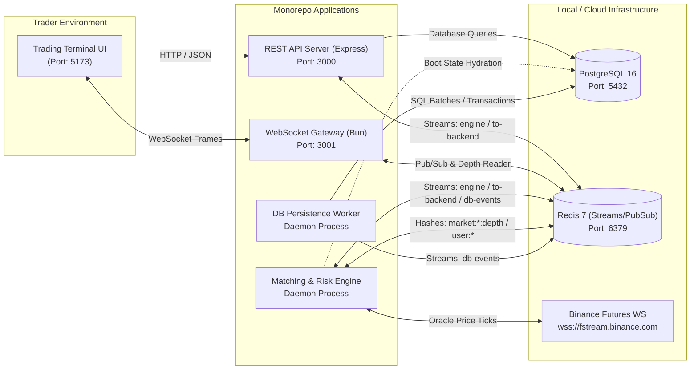
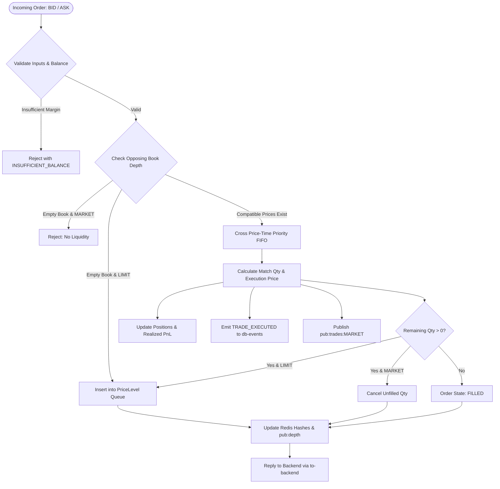
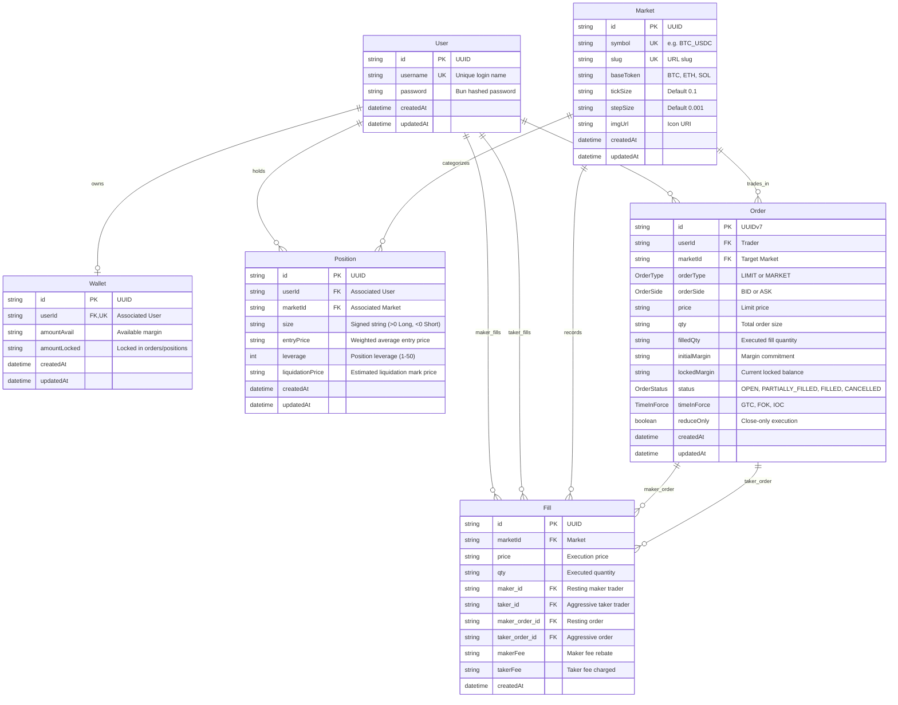

# System Architecture Diagrams

This document contains visual Mermaid diagrams depicting the physical, logical, data, and process relationships across the Perps Trading Platform.

---

## 1. Physical Service & Port Map

---

## 2. Order Matching State Flow

---

## 3. Database Entity Relationship Diagram (ERD)

