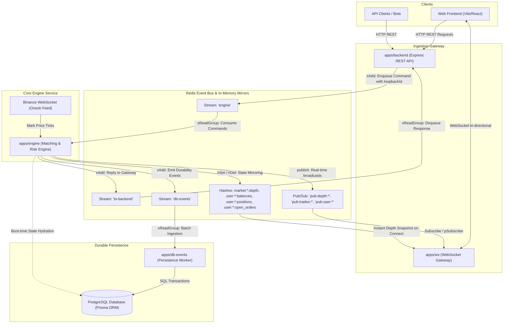

# System Overview

The **Perps Trading Platform** is an enterprise-grade perpetual futures decentralized exchange (DEX) backend and frontend architecture designed for sub-millisecond in-memory order matching, real-time risk evaluation, continuous external mark price tracking, and decoupled asynchronous persistence.

---

## 1. Core Business Purpose

Perpetual futures allow traders to buy (Long) or sell (Short) derivative contracts representing the price movement of an underlying asset (e.g., BTC, ETH, SOL) with leverage, without expiration dates. The platform manages:
1. **Collateral Management**: Traders deposit and withdraw quote collateral (USDC) into their margin wallets.
2. **Order Placement & Execution**: Traders place Limit and Market orders with customizable leverage (1x to 50x) and execution policies (GTC, FOK).
3. **Continuous Matching**: An in-memory matching engine matches aggressive incoming orders against resting maker orders adhering to strict price-time priority.
4. **Leverage & Risk Mitigation**: A risk manager validates initial margin prior to execution, calculates maintenance margin against live external mark prices, and continuously sweeps for under-collateralized positions to execute liquidations.
5. **Funding Rate Settlements**: A periodic funding mechanism calculates price deviation between the perpetual contract and spot oracle feeds, transferring cash flow between long and short positions to keep the perpetual price anchored to the spot market.
6. **Real-time Market Data Delivery**: High-frequency L2 orderbook ladders, public trade prints, and private account state updates are streamed to client browsers over WebSockets.

---

## 2. System Architecture & Topology

The platform decouples synchronous HTTP ingestion, ultra-low latency trade matching, asynchronous database writes, and real-time WebSocket fanout by using **Redis as an event bus and in-memory mirror**, and **PostgreSQL as the durable source of truth**.

---

## 3. Technology Stack Summary

* **Runtime**: [Bun v1.4.3](https://bun.com) across all microservices and packages.
* **Monorepo Manager**: [Turborepo v2.11.9](https://turborepo.dev) with workspaces defined for `apps/*` and `packages/*`.
* **API Framework**: Express v5, CORS middleware, JSON Web Tokens (`jsonwebtoken`).
* **Message Broker & In-Memory Store**: Redis v7 (Redis Streams, Consumer Groups, Pub/Sub, Hashes).
* **Database & ORM**: PostgreSQL with [Prisma ORM v7](https://www.prisma.io) utilizing the native `@prisma/adapter-pg` driver.
* **Frontend**: React 19, TypeScript, Vite, Tailwind CSS, Lucide icons, Zustand state management, and TradingView Lightweight Charts.
* **External Market Data**: Binance public WebSocket (`wss://fstream.binance.com/ws`) for spot/mark price feeds (`btcusdt`, `ethusdt`, `solusdt`).
* **Testing Harness**: Bun native test runner (`bun:test`), Axios, end-to-end multi-party exchange simulations.

---

## 4. Key Design Principles

1. **Deterministic Single-Threaded Matching**: The matching engine runs on a single event loop consuming sequentially from the `engine` Redis stream. This eliminates race conditions, lock contention, and concurrency deadlocks in orderbook execution.
2. **Decoupled Persistence**: Database I/O is completely removed from the critical path of order matching. Order acceptance and execution happen in sub-millisecond memory; durability is achieved asynchronously via Redis Streams and the `db-events` worker.
3. **Synchronous Loopback Pattern**: Although communication between `apps/backend` and `apps/engine` is asynchronous via Redis Streams, `apps/backend` correlates requests with responses using a cryptographically unique `loopbackId` (UUIDv7) and a local `Map<string, DeferredPromise>` with a 10-second timeout.
4. **State Hydration on Boot**: On initialization, `apps/engine` queries PostgreSQL to reconstitute all active markets, wallet balances, open positions, and resting limit orders into memory before opening consumer streams.
5. **Zero-Lag Market Mirroring**: The engine writes L2 depth snapshots, balances, open orders, and positions to Redis Hashes so that read-heavy REST queries (e.g. `/market/depth`, `/live`) bypass the engine entirely.
