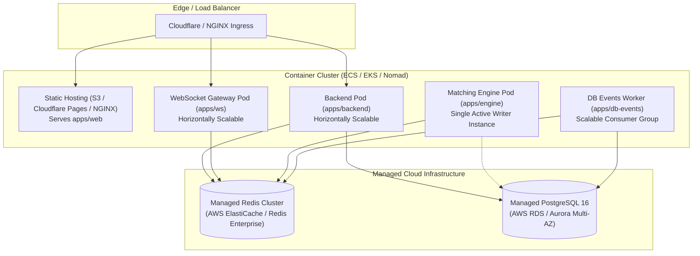

# Build and Deployment Guide

This document describes production compilation, Dockerization, and deployment architectures for the Perps Trading Platform.

---

## 1. Production Build Protocol

The platform utilizes Turborepo to generate optimized production artifacts:

```bash
# Clean previous build artifacts
rm -rf apps/*/dist apps/*/.next

# Compile all workspaces
bun run build
```

* **Frontend (`apps/web`)**: Vite compiles optimized static assets into `apps/web/dist/`.
* **Backend Services (`apps/backend`, `apps/engine`, `apps/ws`, `apps/db-events`)**: Run directly on Bun's native V8-based JavaScript runtime (`bun run index.ts`).

---

## 2. Recommended Production Deployment Architecture



### Critical High-Availability Notes:
1. **Single Matching Engine Writer**: The in-memory matching engine runs deterministically on a single active instance reading sequentially from the `engine` stream. To avoid split-brain order matching, do not run multiple active engine instances on the same market ID.
2. **Stateless Gateways**: `apps/backend` and `apps/ws` are fully stateless and can be scaled horizontally behind an L7 load balancer with sticky sessions for WebSocket connections.
3. **Resilient Persistence**: `apps/db-events` can scale consumers across the `db-consumer-group` to handle high-throughput fill ingestion into PostgreSQL.
