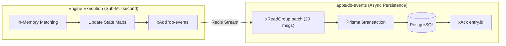

# Data Persistence and Idempotency

This document details how the Perps platform maintains consistency between low-latency in-memory state and durable PostgreSQL storage.

---

## 1. Asynchronous Write Pipeline

To achieve sub-millisecond execution times, disk I/O is completely removed from the trade matching loop. 

---

## 2. Transaction Handling & Idempotency

All multi-record updates in `apps/db-events` run within Prisma interactive transactions (`prisma.$transaction(async (tx) => { ... })`).

### Key Idempotency Patterns:
1. **Order Acceptance (`ORDER_ACCEPTED`)**: Uses `prisma.order.upsert({ where: { id: orderId } })`. If an event is re-delivered due to worker crash recovery, the existing order is unaffected.
2. **Trade Fills (`TRADE_EXECUTED`)**:
   - `Fill.create`: Creates an immutable trade record.
   - `makerOrder.filledQty`: Computed by querying current database filled quantity and adding the delta fill quantity.
   - If an event is re-processed, status transitions (`OPEN` $\to$ `PARTIALLY_FILLED` $\to$ `FILLED`) remain deterministic.
3. **Position Updates (`POSITION_UPDATED`)**: Uses `prisma.position.upsert` with the composite unique key `userId_marketId`.
4. **Wallet Updates (`WALLET_UPDATE`)**: Uses `prisma.wallet.upsert` with `userId`.

---

## 3. Crash Recovery and Consumer Rebalance

If `apps/db-events` terminates unexpectedly:
1. Unacknowledged entries remain in Redis Stream `db-events` Pending Entries List (PEL).
2. Upon restart, the consumer resumes from its last acknowledged sequence ID (`id: ">"`).
3. Redis streams ensure that zero financial events are lost during worker downtime.
