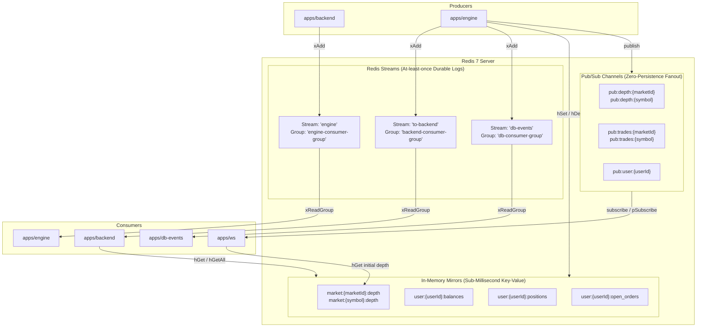

# Redis Architecture and Topology

Redis plays three fundamental roles in the Perps platform:
1. **Durable Message Broker (Streams)**: Decouples REST gateways, matching engines, and database workers using persistent append-only logs and consumer groups.
2. **Real-time Event Fanout (Pub/Sub)**: Distributes high-frequency orderbook changes, public trade prints, and private notifications to WebSocket gateways.
3. **Low-Latency In-Memory Mirror (Hashes)**: Caches active orderbook depth ladders, balances, open orders, and positions so read-heavy client queries bypass the matching engine.

---

## 1. Redis Infrastructure Topology

---

## 2. Redis Streams & Consumer Groups

| Stream Key | Consumer Group | Consumer Name | Purpose | Producers | Consumers |
| :--- | :--- | :--- | :--- | :--- | :--- |
| **`engine`** | `engine-consumer-group` | `engine-worker-1` | Ingests trading and collateral commands from REST gateway | `apps/backend` | `apps/engine` |
| **`to-backend`**| `backend-consumer-group`| `backend-instance-one`| Delivers matching outcomes back to HTTP loopback promises | `apps/engine` | `apps/backend` |
| **`db-events`** | `db-consumer-group` | `db-worker-1` | Queue for durable PostgreSQL persistence (trades, orders, wallets) | `apps/engine` | `apps/db-events` |

### Stream Configuration & Safety:
* Streams are initialized with `MKSTREAM: true` to automatically instantiate the stream key if missing.
* Consumer loops catch `BUSYGROUP` during setup to ensure idempotency on restarts.
* Consumer loops explicitly catch `NOGROUP` at runtime and automatically recreate the missing group, preventing service hangs if Redis is flushed.

---

## 3. In-Memory State Mirrors (Hashes)

| Hash Key Pattern | Field | Value Schema | Modified By | Read By |
| :--- | :--- | :--- | :--- | :--- |
| `market:${marketId}:depth` | `"data"` | JSON depth snapshot `{ marketId, symbol, bids, asks, lastTradedPrice, timestamp }` | `apps/engine` | `apps/backend` (`GET /market/depth`), `apps/ws` (on connect) |
| `market:${symbol}:depth` | `"data"` | Same depth snapshot (keyed by symbol for fast ticker lookup) | `apps/engine` | `apps/backend`, `apps/ws` |
| `user:${userId}:balances` | `"data"` | JSON `{ available_bal, locked_bal }` | `apps/engine` | `apps/backend` (`GET /live`) |
| `user:${userId}:positions`| `${marketId}` | JSON Position object | `apps/engine` (`hSet` on update, `hDel` on close) | `apps/backend` (`GET /live`) |
| `user:${userId}:open_orders`| `${orderId}`| JSON OpenOrder object (`filledQty`, `status`, `price`, `qty`) | `apps/engine` (`hSet` on place/partial, `hDel` on fill/cancel) | `apps/backend` (`GET /live`, `GET /openOrders`) |
