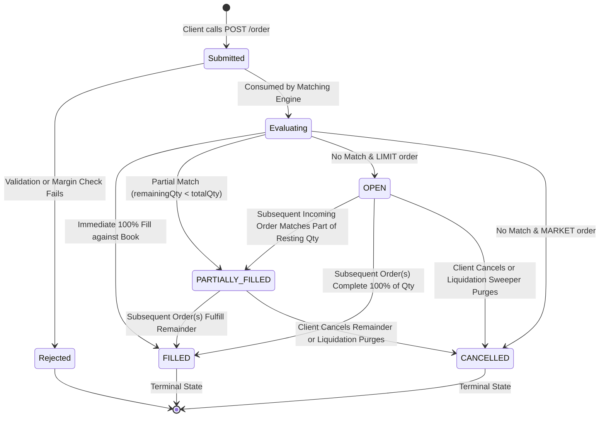

# Order States and Transitions

Files:
* [packages/db/prisma/schema.prisma](file:///c:/Users/777su/Desktop/Perps_Project/Perps/packages/db/prisma/schema.prisma#L14-L19)
* [apps/engine/src/matching-engine/matching.ts](file:///c:/Users/777su/Desktop/Perps_Project/Perps/apps/engine/src/matching-engine/matching.ts)

Orders in the Perps platform transition through four formal states defined in the Prisma `OrderStatus` enum: `OPEN`, `PARTIALLY_FILLED`, `FILLED`, and `CANCELLED`.

---

## 1. Formal State Transition Diagram

---

## 2. State Descriptions

| State | Definition | Location in System | Margin Behavior |
| :--- | :--- | :--- | :--- |
| **`OPEN`** | Resting limit order in the orderbook with 0 executed quantity. | Orderbook `PriceLevel`, Redis `user:UID:open_orders`, PostgreSQL `Order` table. | Required initial margin is locked in `locked_bal`. |
| **`PARTIALLY_FILLED`** | Order has executed at least one fill, but unfilled quantity remains in the orderbook. | Orderbook `PriceLevel`, Redis `user:UID:open_orders`, PostgreSQL `Order` table. | Margin for executed quantity converted to position margin; margin for remaining quantity remains in `locked_bal`. |
| **`FILLED`** | Terminal state. 100% of the requested order quantity has executed. | Removed from Orderbook and Redis `open_orders`. Stored in PostgreSQL `Order` table. | All locked margin converted into active position margin. |
| **`CANCELLED`** | Terminal state. Unfilled portion of an order removed by user request, FOK policy, or liquidation. | Removed from Orderbook and Redis `open_orders`. Status updated in PostgreSQL `Order` table. | All remaining locked margin returned to `available_bal`. |

---

## 3. Maker vs Taker State Resolution

* **Maker Orders**:
  - Start as `OPEN` when resting in the book.
  - When matched against an incoming taker:
    - If `makerOrder.filledQty + matchQty >= makerOrder.qty` $\to$ status transitions to `FILLED`.
    - If `makerOrder.filledQty + matchQty < makerOrder.qty` $\to$ status transitions to `PARTIALLY_FILLED`.
* **Taker Orders**:
  - If `remainingQty === 0` $\to$ status is `FILLED`.
  - If `remainingQty > 0` and `fills.length > 0`:
    - Limit Order $\to$ status is `PARTIALLY_FILLED` (remainder rests as maker in book).
    - Market Order $\to$ status is `PARTIALLY_FILLED` (remainder cancelled).
  - If `remainingQty === qty` (0 fills):
    - Limit Order $\to$ status is `OPEN` (rests in book).
    - Market Order $\to$ status is `CANCELLED`.
