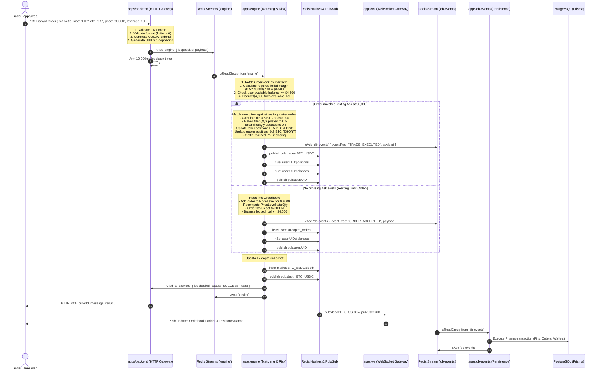

# Complete Trading Lifecycle

This document provides a comprehensive end-to-end trace of an order from the user's browser, through input validation, Redis streams, risk checks, matching engine execution, real-time WebSocket distribution, and asynchronous PostgreSQL persistence.

---

## 1. End-to-End Execution Trace

---

## 2. Order Placement Modes

### 1. Limit Order Placement (`orderType: "LIMIT"`)
* **Price Obligation**: Must supply a valid finite `price > 0`.
* **Execution**:
  - The engine first attempts to match against the opposing book at prices equal to or better than `price`.
  - If unfilled quantity remains (`remainingQty > 0`), the unfilled portion is inserted into the orderbook at `price`.
  - The margin required for the resting portion is locked in the user's wallet (`locked_bal += requiredMargin`).
  - The order is mirrored to Redis Hash `user:${userId}:open_orders`.

### 2. Market Order Placement (`orderType: "MARKET"`)
* **Price Behavior**: The limit `price` is optional (or omitted).
* **Execution**:
  - The engine aggressively sweeps through the opposing orderbook ladder, starting from the best bid/ask, until the requested `qty` is exhausted or available depth is depleted.
  - If the opposing book is exhausted before `qty` is fulfilled, the remaining unfilled quantity is **cancelled** (does not rest in the book).
  - Margin is validated against the best available book price or the latest traded price.

---

## 3. Order Cancellation Lifecycle

1. Trader initiates cancellation via UI or `DELETE /api/v1/order/:orderId`.
2. Backend pushes `CANCEL_ORDER` into Redis stream `engine`.
3. Matching engine locates the order in `book.bids` or `book.asks`.
4. Calculates unfulfilled margin (`(qty - filledQty) * price / leverage`).
5. Releases margin back to the user:
   - `locked_bal -= unfulfilledMargin`
   - `available_bal += unfulfilledMargin`
6. Removes order from the `PriceLevel.orders` array and updates `totalQty`.
7. Deletes from Redis Hash `user:${userId}:open_orders` via `hDel`.
8. Emits `ORDER_CANCELLED` to `db-events` $\to$ `apps/db-events` updates PostgreSQL status to `CANCELLED`.
9. Publishes cancellation update to `pub:user:${userId}` and updated depth to `pub:depth:${marketId}`.
